# Priorização de vulnerabilidades com dados públicos de segurança cibernética

**MVP — Pipeline de dados em nuvem** · Universidade de Brasília · Departamento de Engenharia de Produção
Professor responsável: André Luiz Marques Serrano · Trabalho individual

**Aluno:** Juliano Teles Abrahao · **Matrícula:** 231013411

Plataforma: **Databricks Free Edition** (Unity Catalog, Delta Lake, computação serverless) ·
Linguagens: Python (PySpark) e SQL · Coleta de referência: **28/09/2026**

---

## Sumário

1. [Resumo executivo](#1-resumo-executivo)
2. [Objetivo](#2-objetivo)
3. [Dados: busca, licenças e ética](#3-dados-busca-licenças-e-ética)
4. [Arquitetura do pipeline](#4-arquitetura-do-pipeline)
5. [Coleta](#5-coleta)
6. [Modelagem e Catálogo de Dados](#6-modelagem-e-catálogo-de-dados)
7. [Carga (ETL)](#7-carga-etl)
8. [Análise de qualidade dos dados](#8-análise-de-qualidade-dos-dados)
9. [Solução do problema — respostas às perguntas](#9-solução-do-problema--respostas-às-perguntas)
10. [Discussão geral](#10-discussão-geral)
11. [Autoavaliação](#11-autoavaliação)
12. [Como reproduzir](#12-como-reproduzir)
13. [Evidências](#13-evidências)
14. [Estrutura do repositório](#14-estrutura-do-repositório)
15. [Referências](#15-referências)

---

## 1. Resumo executivo

Uma equipe de segurança recebe **dezenas de milhares de vulnerabilidades novas por ano** (40.704 CVEs
publicadas só em 2024) e tem capacidade para corrigir uma fração delas. O critério mais usado para
decidir a ordem da fila é a **severidade CVSS**. Este MVP cruza quatro bases públicas — o catálogo da
CISA de vulnerabilidades **exploradas de fato** (KEV), o NVD/NIST, o EPSS da FIRST e o catálogo CWE da
MITRE — para verificar, com dados, se essa fila está bem ordenada.

| # | Pergunta | Resposta curta |
|---|---|---|
| P1 | Quem concentra as vulnerabilidades exploradas? | Microsoft (22,5%) lidera, mas a concentração **caiu pela metade**: os 5 maiores fornecedores tinham 57% das inclusões de 2022 e 33% das de 2026 (HHI 1.144 → 414). |
| P2 | Quanto tempo até a exploração? | **Mediana de 10 dias** após a publicação; 48% das exploradas são confirmadas em até 7 dias e 27% no mesmo dia ou antes. |
| P3 | CVSS ou EPSS para priorizar? | **Nenhum venceu com clareza.** Com o mesmo esforço (12% das CVEs), CVSS ≥ 9 cobriu 43% das exploradas depois; EPSS, 29% (diferença não significativa). O EPSS foi melhor com orçamento pequeno (até ~8% das CVEs) e o CVSS, acima disso. E 78% das exploradas de 2024 **já tinham sido exploradas** antes da data da decisão. |
| P4 | Quais fraquezas são exploradas? | Escrita fora dos limites de memória (CWE-787), injeção de comandos (CWE-78) e *path traversal* (CWE-22). *Cross-site scripting* é a fraqueza mais comum, mas **20× menos** propensa à exploração que injeção de comandos. |
| P5 | "Corrigir só as críticas" basta? | **Não: 64% das exploradas não são críticas** — a maioria é de severidade Alta. |

**Conclusão:** a severidade CVSS carrega sinal, mas é um critério lento e grosseiro para um fenômeno
rápido e concentrado. O que mais muda o resultado não é trocar CVSS por EPSS, e sim **quando** se decide:
a priorização precisa ser contínua (diária), acionada pelo KEV e ponderada por tipo de fraqueza.

---

## 2. Objetivo

### 2.1 Problema

Em Engenharia de Produção, a correção de vulnerabilidades é um **problema de fila com capacidade
limitada**: chegam muito mais itens do que é possível processar, e a ordem de atendimento determina o
risco residual. A prática comum é ordenar a fila pela **severidade CVSS** (0 a 10), muitas vezes com
prazos (SLAs) por faixa — por exemplo, "críticas em 15 dias, altas em 30".

Mas o CVSS mede **o quanto uma vulnerabilidade seria grave se explorada**, e não **a probabilidade de
ela ser explorada**. Existe hoje uma evidência direta de exploração — o catálogo **KEV** da CISA — e um
modelo público de probabilidade — o **EPSS** da FIRST. O MVP usa essas fontes para responder se a fila
ordenada por severidade protege contra o que de fato é atacado.

**Hipótese de negócio:** priorizar por probabilidade de exploração (EPSS) cobre mais vulnerabilidades
efetivamente exploradas do que priorizar por severidade (CVSS), com o mesmo esforço de correção.

**Usuário do MVP:** equipe de gestão de vulnerabilidades (SOC / time de infraestrutura) que precisa
definir critérios de priorização e prazos de correção.

### 2.2 Perguntas de negócio

As perguntas foram definidas **antes** da escolha das bases e permanecem íntegras, inclusive a que
não confirmou a hipótese.

| # | Pergunta | Decisão que apoia | Métrica |
|---|---|---|---|
| **P1** | Quais fornecedores e produtos concentram as vulnerabilidades exploradas ativamente, e essa concentração aumentou ou diminuiu desde 2022? | Onde concentrar inventário e monitoramento de ativos | Participação por fornecedor; índice HHI por ano |
| **P2** | Quanto tempo passa entre a publicação de uma vulnerabilidade e a confirmação de sua exploração, e esse tempo está encolhendo? | Prazo (SLA) interno de correção | Mediana de dias; % exploradas em até 7 e 30 dias |
| **P3** | Uma equipe que, em 01/01/2025, priorizasse as vulnerabilidades publicadas em 2024 por CVSS ou por EPSS teria coberto mais das que viriam a ser exploradas, com o mesmo esforço? | Critério de ordenação da fila de correções | Cobertura, esforço e eficiência; IC 95% |
| **P4** | Quais classes de fraqueza (CWE) predominam entre as vulnerabilidades exploradas, e quais se associam a campanhas de ransomware? | Foco de desenvolvimento seguro, testes e treinamento | Frequência; % ransomware; taxa de exploração por CWE |
| **P5** | Que parcela das vulnerabilidades exploradas ficaria de fora de uma política "corrigir só as críticas"? | Política de SLA por severidade | Distribuição por faixa CVSS |

### 2.3 As três dimensões do MVP

| Dimensão | Evidência neste trabalho |
|---|---|
| **Viabilidade técnica** | Pipeline completo (coleta → bronze → silver → gold → qualidade → análise) executando no Databricks Free Edition, orquestrado como Job de 6 tarefas; tabelas Delta persistidas no Unity Catalog. |
| **Viabilidade financeira** | Custo de operação **zero** na Free Edition; todas as fontes são gratuitas. O volume é pequeno (240 MB brutos, ≈ 42 mil CVEs; execução completa em minutos), compatível com uma operação diária de baixíssimo custo mesmo em conta paga. |
| **Desejabilidade** | As cinco perguntas foram respondidas com dados, e os resultados levam a decisões concretas (seções 9 e 10), inclusive uma que contraria a hipótese inicial. |

---

## 3. Dados: busca, licenças e ética

### 3.1 Fontes

| Fonte | Conteúdo | Acesso | Formato | Volume coletado | Licença |
|---|---|---|---|---|---|
| **CISA KEV** — *Known Exploited Vulnerabilities* | Vulnerabilidades com **exploração ativa confirmada**, com data de inclusão, prazo de correção e uso por ransomware | Download direto | JSON | 1.728 vulnerabilidades (catálogo v2026.09.27) | CC0 1.0 |
| **NVD / NIST** — API CVE 2.0 | Dados de cada CVE: publicação, status, notas CVSS (v2 a v4), fraquezas CWE | API REST paginada (2.000 por página, limite de 5 requisições/30 s) | JSON | 42.432 registros (1.728 do KEV + 40.704 publicados em 2024) em 24 páginas | Uso livre (governo dos EUA), com aviso obrigatório |
| **FIRST EPSS** — *Exploit Prediction Scoring System* | Probabilidade de exploração nos próximos 30 dias | Download direto | CSV.gz | 380.224 scores atuais (modelo v2026.06.15) + 271.765 de 01/01/2025 (modelo v2023.03.01) | Uso livre, atribuição solicitada |
| **MITRE CWE** — visão 1000 | Nome e hierarquia de cada classe de fraqueza de software | Download direto | CSV (dentro de ZIP) | 944 fraquezas | Termos de uso da MITRE (uso livre com aviso de copyright) |

**Data da coleta:** 28/09/2026, 19:31–19:45 UTC · **Total:** 28 arquivos, 240,5 MB descompactados
(35 MB como gravados) · **Tempo:** 485 s (dominado pelo limite de requisições do NVD).

> Essa coleta foi feita localmente, para testar o pipeline. Dentro do Databricks a coleta foi **repetida no mesmo dia (28/09/2026, 21:51–21:55 UTC)**, com os mesmos volumes (28 arquivos, 240,5 MB, 42.432 registros do NVD); as tabelas e os resultados apresentados abaixo são dessa execução na nuvem.

O escopo do NVD foi recortado de propósito: todas as CVEs do KEV (para P1, P2, P4 e P5) e **todas as
CVEs publicadas em 2024** (a população de comparação das perguntas P3–P5). Baixar o NVD inteiro
(> 300 mil CVEs) não acrescentaria nada às perguntas e multiplicaria por dez o tempo e o volume.

### 3.2 Ética, licenciamento e proteção de dados

* **Licenças:** todas as fontes permitem uso e redistribuição. Mesmo assim, **os dados brutos não
  são versionados** — por volume, e para que qualquer pessoa obtenha a versão mais recente pelo
  script de coleta. Os avisos obrigatórios (NVD e MITRE) estão no arquivo [`LICENSE`](LICENSE).
* **LGPD (Lei nº 13.709/2018):** os dados descrevem **software**, não pessoas. Não há dados pessoais,
  identificadores de indivíduos nem informação sensível; nenhuma anonimização foi necessária.
* **Dados corporativos:** não foram usados.
* **Termos de uso da API:** o robô de coleta respeita o limite do NVD (pausa de 6,5 s entre
  requisições sem chave), identifica-se por *User-Agent* e aceita chave de API opcional por variável
  de ambiente — nunca versionada.

---

## 4. Arquitetura do pipeline

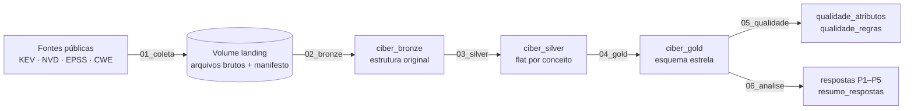

* **Plataforma:** Databricks Free Edition, catálogo `workspace` do Unity Catalog, três schemas
  (`ciber_bronze`, `ciber_silver`, `ciber_gold`) e um Volume (`ciber_bronze.landing`) para os
  arquivos brutos. Todas as tabelas são **Delta**.
* **Orquestração:** Job do Databricks com seis tarefas encadeadas, uma por notebook, em computação
  serverless (definição também disponível como *Asset Bundle* em [`databricks.yml`](databricks.yml)).
* **Um código, dois ambientes:** o módulo [`scripts/ambiente.py`](scripts/ambiente.py) faz os mesmos
  notebooks rodarem no Databricks e em Spark 4.0 local. Todo o pipeline foi **testado localmente de
  ponta a ponta antes da execução na nuvem** ([log](evidencias/execucao_local/log_pipeline.txt)).

**Evidência — Job executado no Databricks.** As seis tarefas (`coleta`, `bronze`, `silver`, `gold`, `qualidade`, `analise`) concluíram com sucesso em **7 min 15 s**. A execução de 44 s marcada como cancelada é uma execução adicional interrompida manualmente; a execução válida é a de 7 min 15 s.

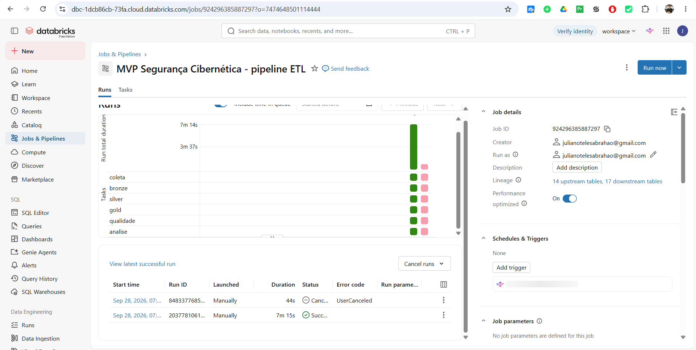

---

## 5. Coleta

Notebook [`01_coleta`](notebooks/01_coleta.py) · robô em [`scripts/coleta.py`](scripts/coleta.py)

* Baixa as quatro fontes e grava os arquivos **byte a byte como publicados** no Volume `landing`,
  organizados em subpastas por fonte. As páginas da API do NVD são gravadas compactadas (gzip).
* Registra um **manifesto** (`_manifesto_coleta.json`, também carregado como tabela
  `ciber_bronze.manifesto_coleta`) com URL, data e hora UTC, tamanho, **hash SHA-256** e número de
  registros de cada arquivo — é o ponto de partida da linhagem e permite provar que os dados
  analisados são os coletados.
* Robustez: novas tentativas com espera exponencial (a API do NVD responde 403/503 ao exceder o
  limite), fonte reserva para o KEV (espelho oficial da CISA no GitHub) e execução idempotente (se o
  manifesto existe, não baixa de novo).
* Se a computação serverless não tiver saída para a internet, o mesmo script roda localmente e a pasta
  é enviada ao Volume pela interface — o restante do pipeline não muda.

**Evidência — dados persistidos na nuvem.** O Volume `workspace.ciber_bronze.landing` contém as pastas `kev`, `nvd`, `epss` e `cwe` (arquivos brutos) e o `_manifesto_coleta.json`:

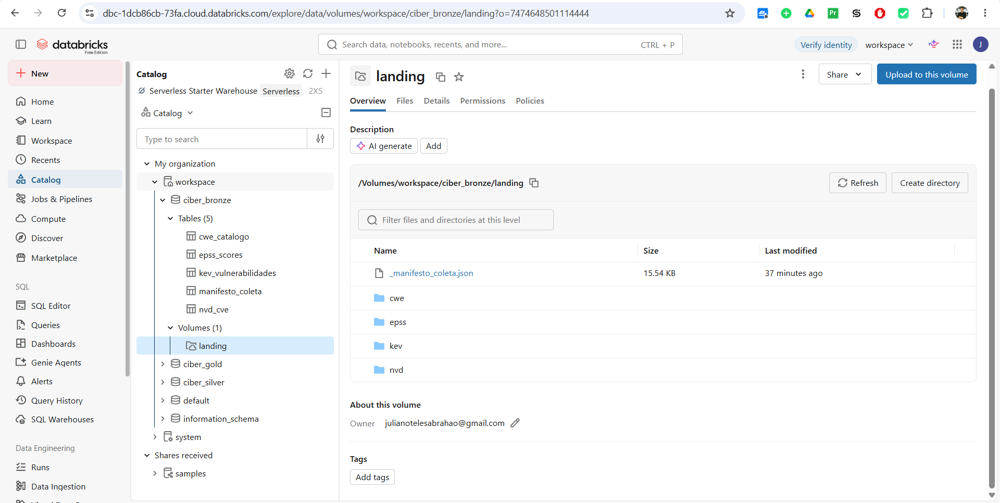

---

## 6. Modelagem e Catálogo de Dados

Detalhes completos: [**Modelo de dados**](catalogo/modelo_de_dados.md) ·
[**Catálogo de Dados**](catalogo/catalogo_de_dados.md)

O modelo combina as duas abordagens pedidas: as camadas bronze e silver são **flat por conceito**
(como num Data Lake) e a camada gold é um **esquema estrela** (como num Data Warehouse).

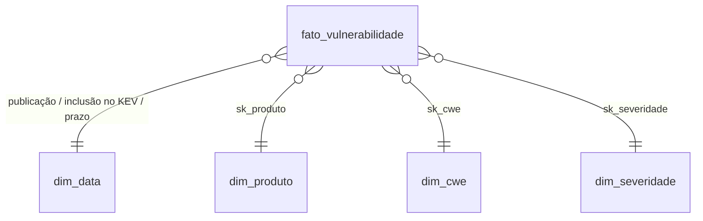

| Tabela | Grão | Linhas | Conteúdo |
|---|---|---|---|
| `fato_vulnerabilidade` | 1 CVE | 41.521 | CVSS (nota, versão, origem), EPSS no corte e atual, inclusão no KEV, ransomware, dias até a exploração, prazo de correção, flags de coorte |
| `dim_data` | 1 dia | 8.865 | Calendário 2002–2026 com três papéis (publicação, inclusão, prazo) |
| `dim_produto` | fornecedor × produto | 720 | Nomenclatura da CISA (283 fornecedores, 719 pares fornecedor/produto) |
| `dim_cwe` | 1 fraqueza | 959 | Código, nome e nível de abstração da MITRE |
| `dim_severidade` | 1 faixa | 6 | Faixas CVSS v3 (Baixa, Média, Alta, Crítica…) |

O **Catálogo de Dados** descreve cada atributo das camadas silver e gold com tipo, descrição, domínio
declarado, **domínio observado** (mínimo–máximo ou categorias encontradas), percentual de nulos,
significado do nulo e **linhagem** (campo de origem + regra aplicada). Ele é gerado por
[`scripts/gerar_catalogo.py`](scripts/gerar_catalogo.py) a partir das tabelas carregadas, para nunca
ficar desatualizado em relação aos dados.

**Evidências no Databricks.** Os três schemas e suas tabelas Delta no Unity Catalog (bronze: 5 tabelas · silver: 4 · gold: 8, entre elas a fato, as dimensões e as tabelas de qualidade):

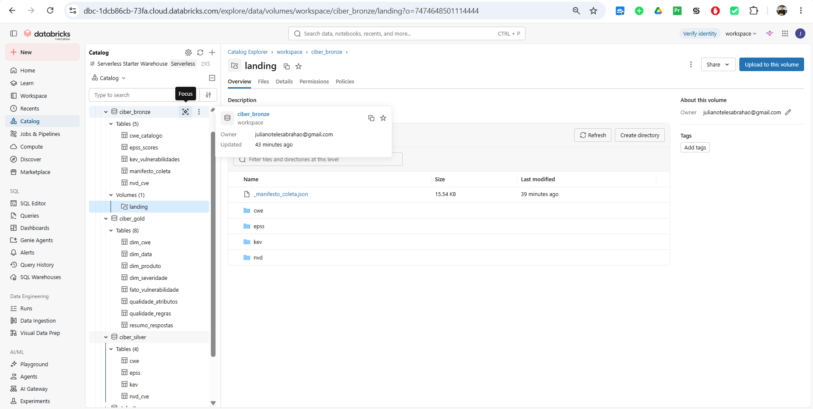

Amostra da tabela fato `fato_vulnerabilidade` (chaves substitutas das dimensões, inclusive o membro `-1`):

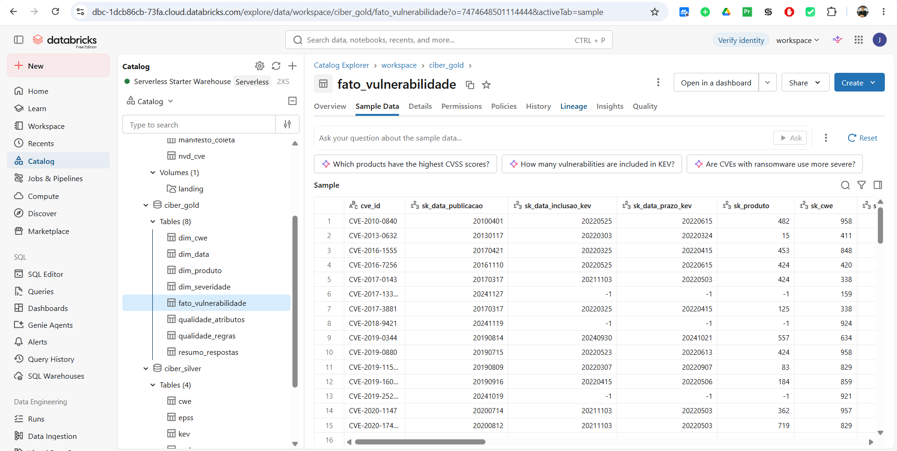

**Linhagem** da fato, gerada automaticamente pelo Unity Catalog: a tabela é alimentada pelas tabelas silver `kev`, `nvd_cve`, `epss` e `cwe`:

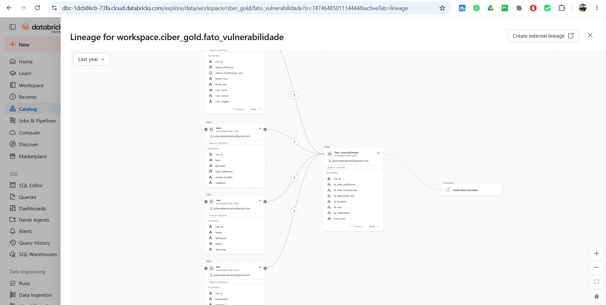

---

## 7. Carga (ETL)

Notebooks [`02_bronze`](notebooks/02_bronze.py), [`03_silver`](notebooks/03_silver.py) e
[`04_gold`](notebooks/04_gold.py). Carga **completa e idempotente**: cada execução sobrescreve as
tabelas (o volume é pequeno, e isso elimina problemas de carga incremental num MVP).

### 7.1 Regras de negócio aplicadas na transformação

| # | Regra | Por quê |
|---|---|---|
| R1 | IDs de CVE em maiúsculas e sem espaços | Chave de junção entre as quatro fontes |
| R2 | `trim()` em fornecedor e produto do KEV | 19 registros tinham espaço final (ex.: `"SimpleHelp "`) — contariam como fornecedores distintos |
| R3 | Datas de texto → `DATE`; `'Known'` → `uso_ransomware = true` | Tipagem |
| R4 | **CVSS escolhido:** v3.1 → v3.0 → v4.0 → v2.0; em cada versão, a nota do NVD precede a do emissor (CNA); versão e origem ficam registradas | Uma CVE pode ter várias notas; v3.x é a versão de referência para SLAs |
| R5 | Faixa de severidade calculada pela nota, com os limites do CVSS v3 | Comparar versões na mesma escala |
| R6 | CWE principal: *Primary* do NVD → *Primary* de outra fonte → primeira informada | Uma CVE pode ter várias CWEs |
| R7 | CVE coletada nos dois escopos (KEV e 2024) vira **uma** linha com flags | 160 CVEs estavam nos dois escopos |
| R8 | EPSS e percentil → `DOUBLE`; fora de [0, 1] descartado | Validação de domínio (nenhum descarte ocorreu) |
| R9 | IDs da MITRE recebem prefixo `CWE-`; códigos especiais do NVD entram no domínio | Conciliar a nomenclatura MITRE × NVD |
| R10 | Deduplicação por chave natural | Unicidade |
| R11 | CVEs **rejeitadas** no NVD saem da fato (751 em 2024), salvo se estiverem no KEV | Foram anuladas pelo emissor |
| R12 | NVD ⟗ KEV por `cve_id` (*full outer join*) | Nenhuma entrada do KEV pode se perder |
| R13 | CWE final: específica do NVD → primeira CWE da CISA → código especial | Aproveitar a classificação da CISA quando o NVD não classifica |
| R14 | Membro `-1` ("Não informado") em todas as dimensões | A fato nunca tem chave nula |
| R15 | População e desfecho da avaliação prospectiva da P3 | Ver seção 9.3 |

### 7.2 Verificações automáticas da carga

* **Conferência de volume:** as contagens da bronze batem exatamente com o manifesto da coleta
  (KEV 1.728; NVD 42.432; EPSS 651.989; CWE 944).
* **Integridade referencial:** zero chaves órfãs nas seis chaves estrangeiras da fato.
* **Grão:** nenhuma CVE repetida na fato. Qualquer violação interrompe o Job (`assert`).

---

## 8. Análise de qualidade dos dados

Notebook [`05_qualidade`](notebooks/05_qualidade.py) · tabelas `ciber_gold.qualidade_atributos` e
`ciber_gold.qualidade_regras` (16 verificações).

**Por atributo:** os 40 atributos das quatro tabelas silver foram perfilados (nulos, distintos,
mínimo, máximo) e testados contra o domínio declarado no catálogo — **zero violações de domínio após
o tratamento**.

**Entre atributos e entre fontes:**

| Dimensão | Verificação | Ocorrências | Impacto | Tratamento |
|---|---|---|---|---|
| Unicidade | CVE repetida no KEV | 0 | — | — |
| Unicidade | CVE repetida entre escopos do NVD | 160 (0,38%) | Dupla contagem | Consolidadas (R7) |
| Conformidade | Espaço nas pontas em fornecedor/produto do KEV | 19 (1,1%) | P1 | `trim()` (R2) |
| Consistência | Prazo de correção anterior à inclusão | 0 | — | — |
| Consistência | Data de inclusão no KEV diverge entre CISA e NVD | 0 de 1.728 | — | — |
| Consistência | Ano do ID da CVE ≠ ano de publicação (coorte 2024) | 7.585 (18,6%) | Definição da coorte | Coorte definida pela **data de publicação** |
| Completude | CVE do KEV sem registro no NVD | 0 | — | — |
| Completude | CVE de 2024 sem nenhuma nota CVSS | 8 (0,02%) | P3 | Fora da população |
| Completude | CVE de 2024 sem EPSS em 01/01/2025 | 497 (1,2%) | P3 | Fora da população |
| Completude | Explorada sem CWE específica | 146 (8,4%) | P4 | Mostrada como categoria própria |
| Conformidade | CWE citada que não existe na visão 1000 da MITRE | 12 IDs | P4 | Incluída na dimensão com nome explicativo |
| Acurácia | Incluída no KEV **antes** da publicação no NVD | 65 (3,8%) | P2 | Plausível (exploração anterior à divulgação); mantida |
| Atualidade | CVE de 2024 **sem análise própria do NVD** (status *Deferred* ou em análise) | 7.774 (19,5%) | P3, P5 | Nota do emissor aceita (R4) |
| Atualidade | CVE de 2024 cuja nota CVSS veio do emissor, não do NVD | 16.791 (42,0%) | P3, P5 | Origem registrada; ver limitações |

**Leitura:** as bases são bem curadas — não há duplicatas, datas contraditórias ou valores fora de
faixa. Os problemas relevantes são de **atualidade e completude do NVD**: o acúmulo de análises
pendentes do NIST, iniciado em 2024, deixou um quinto das CVEs daquele ano sem análise própria, e
42% das notas usadas vêm do emissor da CVE. Esses casos foram mantidos (excluí-los enviesaria a
amostra para CVEs "mais importantes"), com a origem da nota registrada em `cvss_origem`.

**Evidência — tabela `qualidade_regras` no Databricks** (16 verificações; a tabela acima resume as principais):

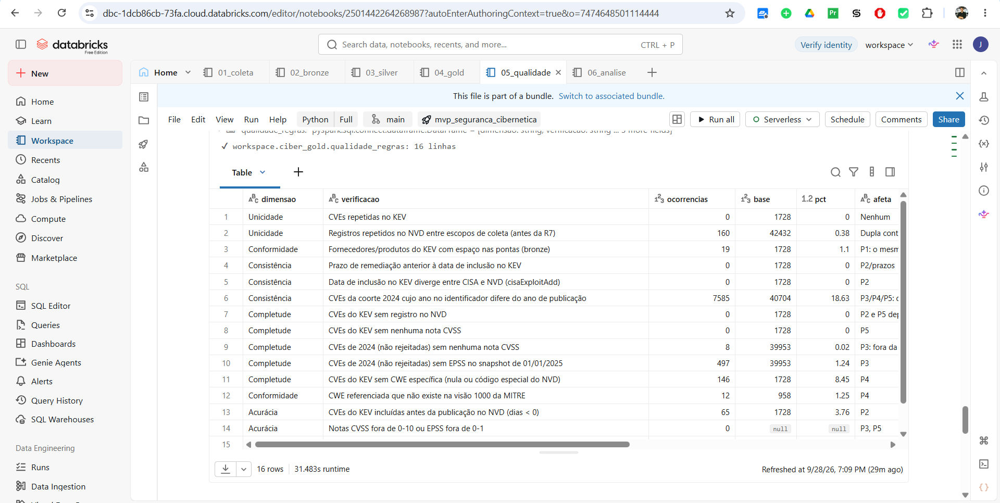

---

## 9. Solução do problema — respostas às perguntas

Notebook [`06_analise`](notebooks/06_analise.py) · consultas SQL equivalentes em
[`sql/consultas_analise.sql`](sql/consultas_analise.sql) · indicadores em `ciber_gold.resumo_respostas`.

### 9.1 P1 — Concentração por fornecedor

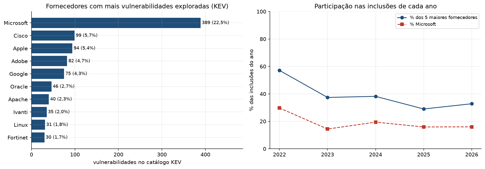

*Evidência — mesmo resultado na execução no Databricks (notebook `06_analise`):*

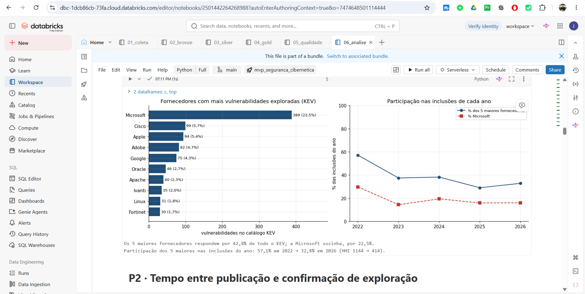

| Ano de inclusão | Inclusões | Fornecedores distintos | % 5 maiores | % Microsoft | HHI |
|---|---|---|---|---|---|
| 2021 (nov–dez) | 311 | 73 | 48,9% | 26,7% | 913 |
| 2022 | 555 | 98 | 57,1% | 29,7% | 1.144 |
| 2023 | 187 | 67 | 37,4% | 14,4% | 476 |
| 2024 | 186 | 64 | 38,2% | 19,4% | 572 |
| 2025 | 245 | 99 | 29,0% | 15,9% | 377 |
| 2026 (até 27/09) | 244 | 94 | 32,8% | 16,0% | 414 |

**Resposta.** No acumulado, cinco fornecedores respondem por 42,8% das 1.728 vulnerabilidades
exploradas — Microsoft (389; 22,5%), Cisco (99), Apple (94), Adobe (82) e Google (75). O produto
isolado mais atingido é o **Windows** (174). Mas a concentração **caiu de forma consistente**: a
participação dos cinco maiores nas inclusões do ano foi de 57% (2022) para 29–33% (2025–2026), e o
índice HHI passou de 1.144 para cerca de 400 — muito abaixo de 1.500, o limiar usual de mercado
"não concentrado".

**Discussão.** Parte do pico de 2021–2022 é artificial: o catálogo foi criado em novembro de 2021 e
recebeu um lote inicial de vulnerabilidades antigas, majoritariamente de grandes fornecedores. Ainda
assim, de 2023 em diante a tendência continua: 2025 teve 99 fornecedores distintos em 245 inclusões.
O ataque migrou para uma **cauda longa** de fornecedores — muitos deles de equipamentos de borda
(Fortinet, Ivanti, Citrix), que também têm as maiores taxas de uso por ransomware (Fortinet: 14 de
30). **Decisão:** um inventário de ativos que cubra bem apenas os grandes fornecedores deixa de fora
a maior parte do que é atacado hoje; o monitoramento do KEV precisa ser cruzado com o inventário
completo.

### 9.2 P2 — Tempo até a exploração

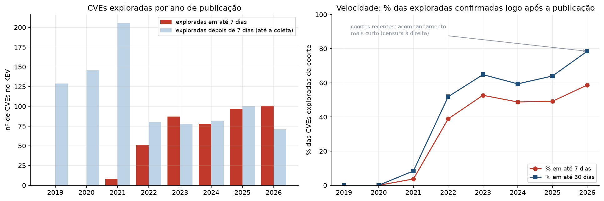

*Evidência — mesmo resultado na execução no Databricks (notebook `06_analise`):*

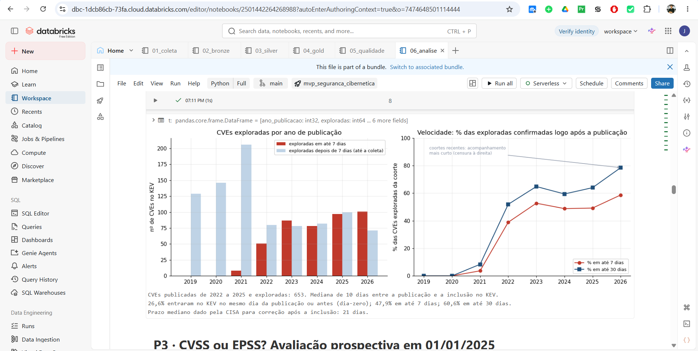

| Ano de publicação | Exploradas | Mediana (dias) | Em até 7 dias | Em até 30 dias |
|---|---|---|---|---|
| 2022 | 131 | 24 | 51 (38,9%) | 68 (51,9%) |
| 2023 | 165 | 6 | 87 (52,7%) | 107 (64,8%) |
| 2024 | 160 | 11 | 78 (48,8%) | 95 (59,4%) |
| 2025 | 197 | 8 | 97 (49,2%) | 126 (64,0%) |
| 2026 (parcial) | 172 | 4 | 101 (58,7%) | 135 (78,5%) |

**Resposta.** Para as vulnerabilidades publicadas de 2022 a 2025 que foram exploradas (653), a
**mediana é de 10 dias** entre a publicação e a confirmação de exploração. **26,6% entraram no KEV no
mesmo dia da publicação ou antes** (exploradas como *zero-day*), 47,9% em até 7 dias e 60,6% em até 30.

**Discussão.** O tempo **não está encolhendo em proporção** — a fração explorada em até 7 dias ficou
estável em torno de 50% entre 2023 e 2025 —, mas **o número absoluto de explorações rápidas cresceu
~90%** (51 em 2022 → 97 em 2025), e 2026 já tem 101 em nove meses. O número da coorte de 2026
precisa ser lido com cuidado: há **censura à direita** — CVEs recentes só entram no KEV se exploradas
rapidamente, porque as lentas ainda não tiveram tempo. Por isso a comparação justa entre anos usa as
**contagens** de explorações em até 7/30 dias, e não a mediana. **Decisão:** um SLA de 30 dias a partir
da publicação chega tarde para ~60% das vulnerabilidades que serão exploradas. Vulnerabilidades que
entram no KEV exigem ação em **dias**, e o KEV precisa ser monitorado diariamente — o prazo mediano
que a própria CISA dá após a inclusão é de 21 dias.

### 9.3 P3 — CVSS ou EPSS? (avaliação prospectiva)

**Desenho (regra R15).** Simulamos uma equipe que, em **01/01/2025**, olhava para as CVEs publicadas
em 2024 que ainda não estavam no KEV, conhecendo apenas o CVSS e o EPSS **daquela data** (arquivo
histórico do EPSS de 01/01/2025). Depois, verificamos quais entraram no KEV entre 02/01/2025 e a
coleta. Como o EPSS é anterior ao desfecho, não há vazamento de informação do futuro.

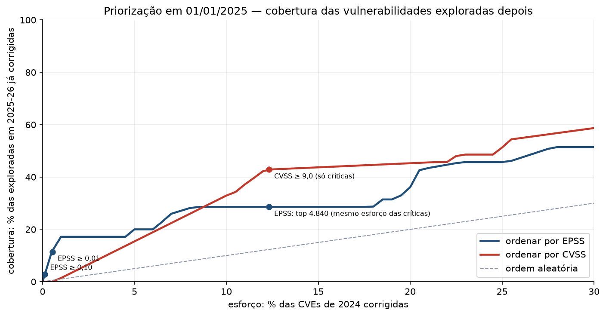

*Evidência — mesmo resultado na execução no Databricks (notebook `06_analise`):*

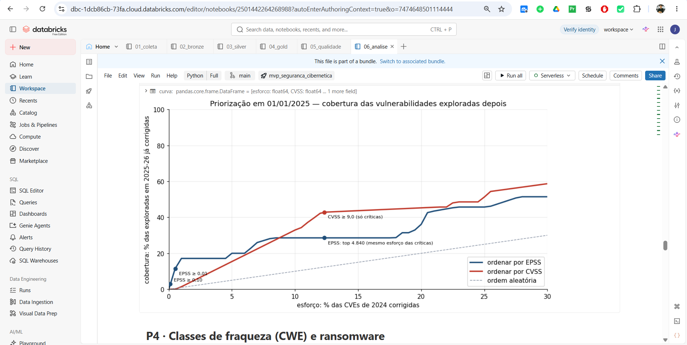

| Política | CVEs a corrigir | Esforço | Cobertura | Eficiência |
|---|---|---|---|---|
| CVSS ≥ 9,0 (só críticas) | 4.840 | 12,3% | **42,9%** (15/35) | 0,31% |
| EPSS: mesmas 4.840 com maior score | 4.840 | 12,3% | **28,6%** (10/35) | 0,21% |
| CVSS ≥ 7,0 (altas e críticas) | 19.057 | 48,5% | 85,7% (30/35) | 0,16% |
| EPSS ≥ 0,01 | 208 | 0,5% | 11,4% (4/35) | 1,92% |
| EPSS ≥ 0,10 | 45 | 0,1% | 2,9% (1/35) | 2,22% |

| Orçamento (esforço) | 0,5% | 1% | 2% | 5% | 10% | 20% |
|---|---|---|---|---|---|---|
| Cobertura esperada — CVSS | 0,0% | 1,4% | 4,9% | 15,4% | 32,9% | 45,3% |
| Cobertura esperada — EPSS | 11,4% | 17,1% | 17,1% | 20,0% | 28,6% | 36,1% |

*Empates:* o CVSS tem apenas 84 valores distintos nesta população. Para escolher as 1% mais graves
(393 CVEs) é preciso desempatar entre **3.850 CVEs com nota 9,8** — o CVSS não diferencia nada dentro
desse grupo. Um sorteio mudaria o resultado a cada execução; por isso a cobertura de cada lista é o
**valor esperado exato** com desempate uniforme, para os dois critérios.

**Resposta.** **A hipótese não se confirmou.** Com o mesmo esforço da política "só críticas", o CVSS
cobriu 42,9% das exploradas depois e o EPSS, 28,6%. A diferença (−14,3 p.p.) **não é
estatisticamente significativa**: intervalo de confiança de 95% por *bootstrap* de −31,0 a +4,0 p.p.
O EPSS foi **melhor com orçamento pequeno** — com 1% das CVEs, cobriu 17% das exploradas contra 1,4%
do CVSS, e suas listas curtas têm eficiência até 7× maior —, e o CVSS passou à frente a partir de
cerca de 8,5% de esforço, justamente quando a lista começa a incluir as notas 9,x inteiras.

**Discussão — o achado mais importante está antes da tabela.** Das 160 CVEs de 2024 que entraram no
KEV, **125 (78%) já estavam lá em 01/01/2025**. Uma decisão tomada numa data fixa já chega tarde para
quatro de cada cinco explorações — o que conecta P3 a P2. As 35 restantes são justamente as de
exploração **tardia e menos previsível**: 31 delas tinham EPSS abaixo de 0,01 na data de corte, e boa
parte só subiu para perto de 1 depois que a exploração começou. Três cuidados de interpretação:

1. **Amostra pequena** (35 casos): por isso o intervalo de confiança é largo e o resultado é
   **inconclusivo**, não uma prova de que o CVSS é melhor.
2. **Versão do modelo:** o EPSS de 01/01/2025 é o modelo v3 (2023); a versão atual do EPSS (v4, 2025)
   não pôde ser avaliada de forma prospectiva.
3. **Possível viés a favor do CVSS:** a nota CVSS usada é a da data da coleta. As 35 exploradas
   estão todas com status *Analyzed* no NVD (contra 44% da população), o que mostra que o NIST
   prioriza a análise de CVEs exploradas. Verifiquei se isso inflou as notas: a média é praticamente
   igual entre notas do NVD e do emissor (8,2 × 8,3 entre as exploradas; 6,9 × 6,9 na população) —
   não há evidência de viés, mas ele não pode ser descartado.

**Decisão:** CVSS e EPSS são **complementares**, não substitutos: o EPSS resolve o problema que o
CVSS não resolve — **ordenar dentro das notas empatadas** e escolher uma lista curta (≈ 1% das CVEs)
para ação imediata —, e o CVSS ordena o restante da fila. Acima de ambos, a fila precisa ser
**reordenada todos os dias**, e não em ciclos periódicos.

### 9.4 P4 — Classes de fraqueza e ransomware

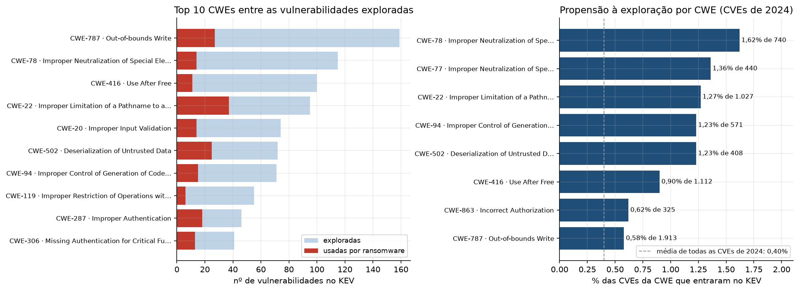

*Evidência — mesmo resultado na execução no Databricks (notebook `06_analise`):*

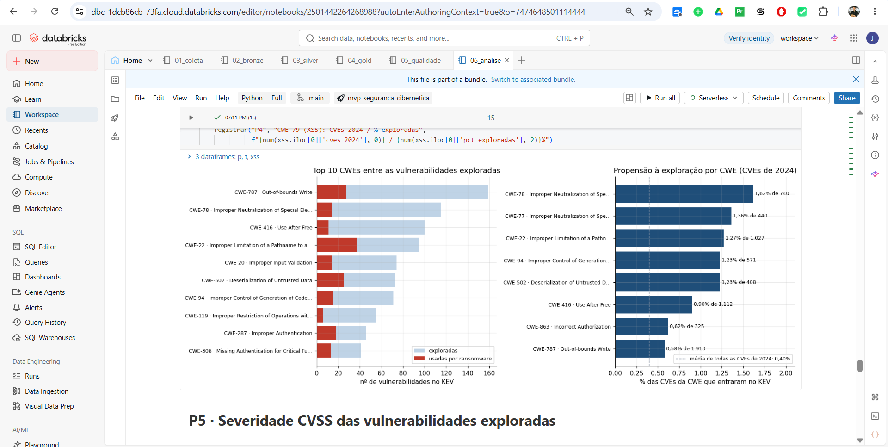

| CWE | Nome | Exploradas | % do KEV | % usadas por ransomware |
|---|---|---|---|---|
| CWE-787 | *Out-of-bounds Write* | 159 | 9,2% | 17,0% |
| CWE-78 | *OS Command Injection* | 115 | 6,7% | 12,2% |
| CWE-416 | *Use After Free* | 100 | 5,8% | 11,0% |
| CWE-22 | *Path Traversal* | 95 | 5,5% | **38,9%** |
| CWE-20 | *Improper Input Validation* | 74 | 4,3% | 18,9% |
| CWE-502 | *Deserialization of Untrusted Data* | 72 | 4,2% | **34,7%** |
| CWE-94 | *Code Injection* | 71 | 4,1% | 21,1% |
| CWE-287 | *Improper Authentication* | 46 | 2,7% | **39,1%** |
| CWE-306 | *Missing Authentication for Critical Function* | 41 | 2,4% | 31,7% |
| CWE-843 | *Type Confusion* | 40 | 2,3% | 2,5% |
| — | Sem CWE específica | 146 | 8,4% | — |

Média de uso por ransomware entre todas as exploradas: **20,9%**.

**Propensão à exploração** — entre todas as CVEs publicadas em 2024 de cada CWE (mínimo de 300), a
fração que entrou no KEV (média geral: 0,40%):

| CWE | CVEs em 2024 | Exploradas | Taxa |
|---|---|---|---|
| CWE-78 *OS Command Injection* | 740 | 12 | **1,62%** |
| CWE-77 *Command Injection* | 440 | 6 | 1,36% |
| CWE-22 *Path Traversal* | 1.027 | 13 | 1,27% |
| CWE-94 *Code Injection* | 571 | 7 | 1,23% |
| CWE-502 *Deserialization* | 408 | 5 | 1,23% |
| CWE-89 *SQL Injection* | 2.632 | 6 | 0,23% |
| CWE-79 *Cross-site Scripting* | **7.275** | 6 | **0,08%** |
| CWE-862 *Missing Authorization* | 1.811 | 0 | 0,00% |

**Resposta.** As exploradas se dividem em dois grupos: **corrupção de memória** (CWE-787, 416, 119,
843), típica de navegadores e sistemas operacionais, e **injeção e travessia de caminhos** (CWE-78,
22, 94, 502), típica de aplicações de servidor e equipamentos de borda. O ransomware prefere o
segundo grupo e as **falhas de autenticação**: *path traversal*, desserialização e autenticação
aparecem em ransomware em 35–39% dos casos, quase o dobro da média — são as que dão **acesso inicial**
a redes corporativas. Já as falhas de memória em navegador quase nunca aparecem em ransomware
(*type confusion*: 2,5%).

**Discussão.** A comparação de volume com propensão é o resultado mais acionável: **XSS é a fraqueza
mais publicada** (7.275 CVEs em 2024, 18% do total) e **uma das menos exploradas** (0,08% — 20 vezes
menos que injeção de comandos). Uma fila guiada por volume gastaria esforço desproporcional nela.
**Decisão:** priorizar em testes e desenvolvimento seguro a injeção de comandos, *path traversal*,
desserialização e autenticação em sistemas expostos à internet.

### 9.5 P5 — "Corrigir só as críticas" basta?

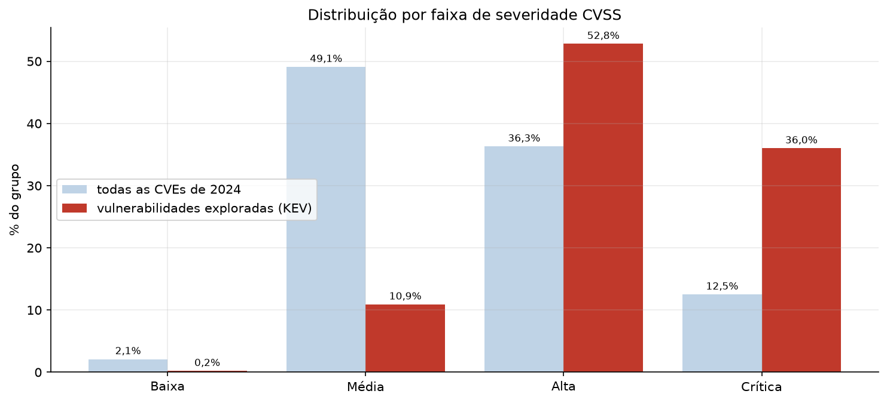

*Evidência — mesmo resultado na execução no Databricks (notebook `06_analise`):*

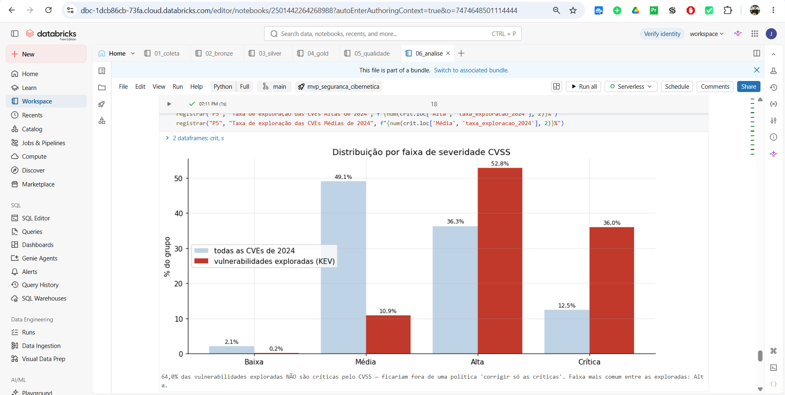

| Faixa CVSS | Exploradas (todas) | % | CVEs de 2024 | % | Taxa de exploração em 2024 |
|---|---|---|---|---|---|
| Baixa | 4 | 0,2% | 828 | 2,1% | 0,12% |
| Média | 189 | 10,9% | 19.635 | 49,1% | 0,07% |
| Alta | 913 | **52,8%** | 14.484 | 36,3% | 0,52% |
| Crítica | 622 | 36,0% | 4.997 | 12,5% | **1,38%** |

**Resposta.** **64,0% das vulnerabilidades exploradas não são críticas** e ficariam fora de uma
política "corrigir só as críticas". A faixa mais comum entre as exploradas é a **Alta** (52,8%).

**Discussão.** A severidade não é inútil: uma CVE crítica tem 2,7 vezes a chance de ser explorada de
uma alta e 20 vezes a de uma média. Mas as críticas são poucas e as altas são muitas, de modo que, em
números absolutos, a maior parte do que é explorado está na faixa Alta. Incluir as altas (CVSS ≥ 7)
cobre 89% das exploradas — ao custo de tratar quase metade de todas as CVEs (P3: 48,5% de esforço).
**Decisão:** um SLA por severidade precisa incluir a faixa Alta e ser **escalonado** por sinais de
exploração (KEV, EPSS alto), em vez de depender apenas do corte em 9,0.

**Evidência — tabela `resumo_respostas` no Databricks**, com os indicadores-chave de P1 a P5 (a mesma tabela é consultável no SQL Editor):

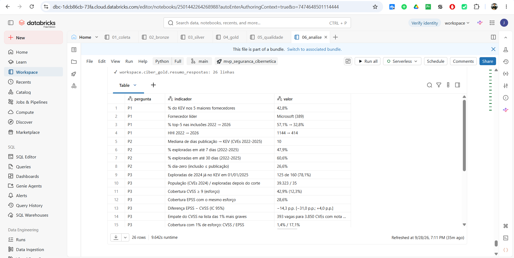

---

## 10. Discussão geral

As cinco respostas descrevem o mesmo fenômeno por ângulos diferentes: **a exploração é rápida (P2),
concentrada em tipos específicos de fraqueza (P4) e cada vez mais espalhada entre fornecedores (P1)**,
enquanto a severidade CVSS — o critério mais usado — é um sinal verdadeiro, porém grosseiro (P5), que
deixa de fora a maioria das exploradas quando usado com cortes rígidos.

A hipótese do trabalho (EPSS supera CVSS com o mesmo esforço) **não foi confirmada** (P3). O
resultado é inconclusivo em favor de qualquer um dos dois, mas é informativo por outro motivo: ele
mostrou que **o momento da decisão importa mais do que o critério**. Quatro em cada cinco
explorações de 2024 aconteceram antes da data em que a fila foi montada. Isso aponta para uma mudança
de processo, e não de métrica:

1. **Gatilho por evento:** entrada no KEV de um produto que a organização usa → correção em dias,
   independentemente do CVSS;
2. **Triagem diária por probabilidade:** a lista curta de maior EPSS (≈ 1% das CVEs) é onde o EPSS
   se mostrou mais eficiente — e ele desempata as milhares de CVEs com a mesma nota CVSS;
3. **Fila de fundo por severidade:** CVSS ≥ 7 ordena o restante, com prioridade extra às classes de
   fraqueza de maior propensão (injeção de comandos, *path traversal*, desserialização, autenticação).

Em termos de Engenharia de Produção: o problema deixa de ser "qual regra de sequenciamento usar numa
fila estática" e passa a ser "com que frequência reprogramar uma fila cuja prioridade dos itens muda
depois que eles chegam" — uma programação **dinâmica**, e não estática.

---

## 11. Autoavaliação

**Quais perguntas foram respondidas e quais não?**
As cinco foram respondidas com dados. P1, P2, P4 e P5 têm respostas firmes. **P3 foi respondida, mas
de forma inconclusiva**: com 35 casos, o intervalo de confiança da diferença entre CVSS e EPSS inclui
o zero; a hipótese não foi confirmada nem refutada com segurança. Na P1, a parte "produto" ficou
limitada à nomenclatura da CISA, que às vezes agrupa itens ("Multiple Products").

**Que limitações dos dados condicionaram os resultados?**
* O **KEV registra exploração conhecida e confirmada**, com foco no governo dos EUA; ausência no KEV
  não significa que a vulnerabilidade nunca foi explorada.
* O **acúmulo de análises do NVD** deixou 19,5% das CVEs de 2024 sem análise própria e fez 42% das
  notas virem do emissor.
* O **CVSS disponível é o da data da coleta**, não o de 01/01/2025 (possível vazamento, investigado na
  seção 9.3).
* O **EPSS histórico** é de um modelo anterior ao atual.
* Não há **contexto de ativos**: a priorização real depende de a organização usar o produto afetado.

**Que decisões técnicas eu tomaria de outra forma?**
* **Janela maior de coleta no NVD** (2023 e 2024) e **várias datas de corte** em vez de uma, para
  aumentar os casos da P3 e dar estabilidade ao resultado.
* Coletar o **histórico de alterações** das CVEs (API *CVE Change History* do NVD) para usar o CVSS
  exatamente como estava na data de corte.
* Testar a **saída para a internet do serverless** do Databricks logo no início, para não depender da
  alternativa de envio manual.
* Interpretar os **CPEs do NVD** para ter fornecedor/produto também nas CVEs fora do KEV.

**Que extensões transformariam o MVP em solução de uso contínuo?**
* **Job diário agendado** com carga **incremental** (`MERGE` no Delta; NVD por `lastModStartDate`) em
  vez de sobrescrever tudo.
* **Histórico versionado** do KEV e do EPSS (dimensões de mudança lenta tipo 2) para acompanhar a
  evolução dos scores.
* **Cruzamento com o inventário de ativos** e com a saída de scanners de vulnerabilidades da
  organização — é isso que transforma a análise em uma fila de trabalho real.
* **Alertas** quando uma nova entrada do KEV atingir um produto do inventário, e um **painel** no
  Databricks (AI/BI Dashboards) para a equipe.
* **Expectativas de qualidade** declarativas (Lakeflow Declarative Pipelines) no lugar das
  verificações em notebook.

---

## 12. Como reproduzir

### 12.1 No Databricks (Free Edition)

1. Crie uma conta gratuita em <https://www.databricks.com/learn/free-edition>.
2. **Workspace → Create → Git folder** e informe a URL deste repositório (público; não precisa de
   credenciais para clonar).
3. Abra `notebooks/01_coleta` e execute com a computação **Serverless**. Ele cria os schemas
   `ciber_bronze`, `ciber_silver`, `ciber_gold` e o Volume `landing`, e baixa os dados (~8 min, por
   causa do limite da API do NVD).
   *Se o download falhar por falta de acesso à internet:* no seu computador, rode
   `python scripts/coleta.py --destino dados/landing` e envie o conteúdo de `dados/landing` para o
   Volume em *Catalog → workspace → ciber_bronze → landing → Upload to this volume*, mantendo as
   subpastas. Depois, execute o notebook novamente.
4. **Pipeline como Job:** *Jobs & Pipelines → Create → Job*. Crie seis tarefas do tipo *Notebook*
   (`01_coleta` a `06_analise`, na pasta `notebooks` do Git folder), cada uma dependente da anterior,
   com computação *Serverless*, e clique em *Run now*. (Alternativa pela CLI:
   `databricks bundle deploy && databricks bundle run pipeline_mvp_ciber`.)
5. Consultas: abra `sql/consultas_analise.sql` no *SQL Editor*.

### 12.2 Localmente (usado para testar o pipeline antes da nuvem)

```bash
pip install -r requirements.txt          # requer também um JDK 17 ou 21 (JAVA_HOME)
python scripts/coleta.py --destino dados/landing
python scripts/executar_local.py         # executa os 6 notebooks em Spark local
python scripts/gerar_catalogo.py         # atualiza catalogo/catalogo_de_dados.md
```

---

## 13. Evidências

* **Gráficos das respostas:** [`evidencias/graficos/`](evidencias/graficos/) (inseridos na seção 9).
* **Execução local completa** (teste antes da nuvem): [`log_coleta.txt`](evidencias/execucao_local/log_coleta.txt)
  e [`log_pipeline.txt`](evidencias/execucao_local/log_pipeline.txt) — coleta de 28 arquivos, carga de
  todas as tabelas, verificações de integridade e resultados de P1–P5.
* **Execução na nuvem (Databricks):** 12 capturas de tela em [`evidencias/databricks/`](evidencias/databricks/), cada uma referenciada no ponto do texto que ela sustenta:

| Captura | Comprova | Seção |
|---|---|---|
| `01_job_execucao` | Job com as 6 tarefas concluídas (7 min 15 s) | 4 |
| `02_volume_landing` | Arquivos brutos e manifesto persistidos no Volume | 5 |
| `03_schemas_tabelas` | Schemas e tabelas Delta no Unity Catalog | 6 |
| `04_fato_amostra` | Dados da tabela fato | 6 |
| `05_linhagem` | Grafo de linhagem (Unity Catalog) | 6 |
| `06_qualidade_regras` | Verificações de qualidade | 8 |
| `07_p1_fornecedores` … `11_p5_severidade` | Resultado de cada pergunta (P1 a P5) | 9.1–9.5 |
| `12_resumo_respostas` | Indicadores-chave gravados em tabela | 9 |

  As capturas foram recortadas para mostrar apenas a área do Databricks (a barra de endereço com o endereço do workspace foi mantida). Lista e instruções: [`evidencias/README.md`](evidencias/README.md).

---

## 14. Estrutura do repositório

| Caminho | Conteúdo |
|---|---|
| `README.md` | Este documento |
| `notebooks/` | `01_coleta` … `06_analise` — pipeline completo (formato de notebook do Databricks) |
| `scripts/` | `coleta.py` (robô de coleta), `ambiente.py` (configuração Databricks/local), `executar_local.py`, `gerar_catalogo.py` |
| `sql/` | Consultas das perguntas para o SQL Editor |
| `catalogo/` | [Modelo de dados](catalogo/modelo_de_dados.md) (diagramas) e [Catálogo de Dados](catalogo/catalogo_de_dados.md) |
| `evidencias/` | Gráficos, logs de execução e capturas do Databricks |
| `databricks.yml` | Definição do Job como Asset Bundle (opcional) |
| `LICENSE` | Licença MIT do código e registro das licenças dos dados |

---

## 15. Referências

* CISA. *Known Exploited Vulnerabilities Catalog*. <https://www.cisa.gov/known-exploited-vulnerabilities-catalog>
* CISA. *Binding Operational Directive 22-01 — Reducing the Significant Risk of Known Exploited Vulnerabilities*, 2021.
* NIST. *National Vulnerability Database — API CVE 2.0*. <https://nvd.nist.gov/developers/vulnerabilities>
  — *This product uses data from the NVD API but is not endorsed or certified by the NVD.*
* FIRST. *Common Vulnerability Scoring System v3.1: Specification Document*. <https://www.first.org/cvss/>
* FIRST. *Exploit Prediction Scoring System (EPSS)*. <https://www.first.org/epss/>
* Jacobs, J.; Romanosky, S.; Edwards, B.; Roytman, M.; Adjerid, I. Exploit Prediction Scoring System
  (EPSS). *Digital Threats: Research and Practice*, v. 2, n. 3, 2021.
* MITRE. *Common Weakness Enumeration (CWE)*. <https://cwe.mitre.org/> — CWE™ é marca registrada da
  The MITRE Corporation.
* Databricks. *Databricks Free Edition*. <https://docs.databricks.com/aws/en/getting-started/free-edition>
