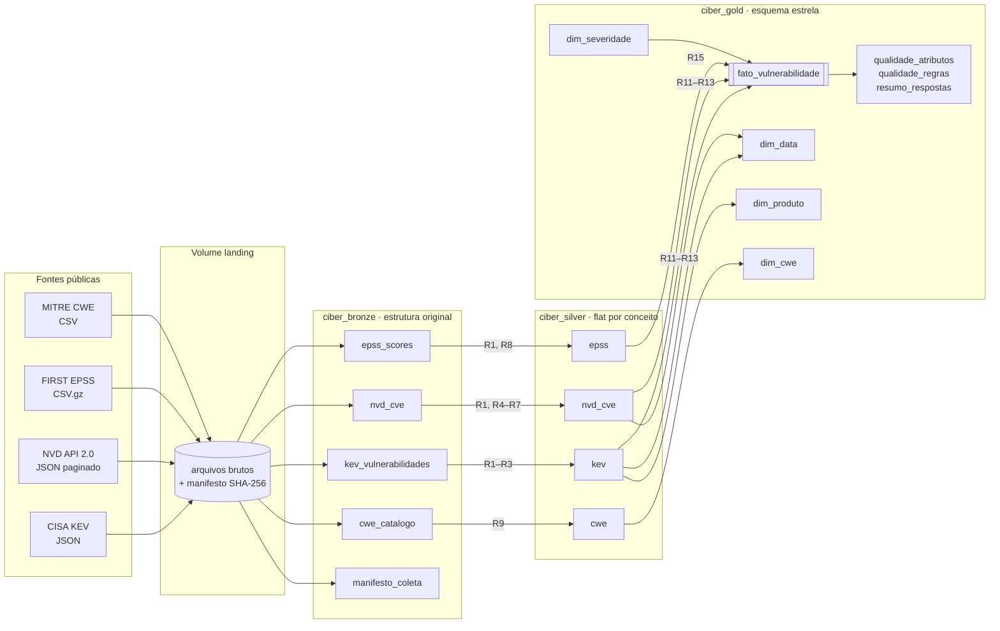
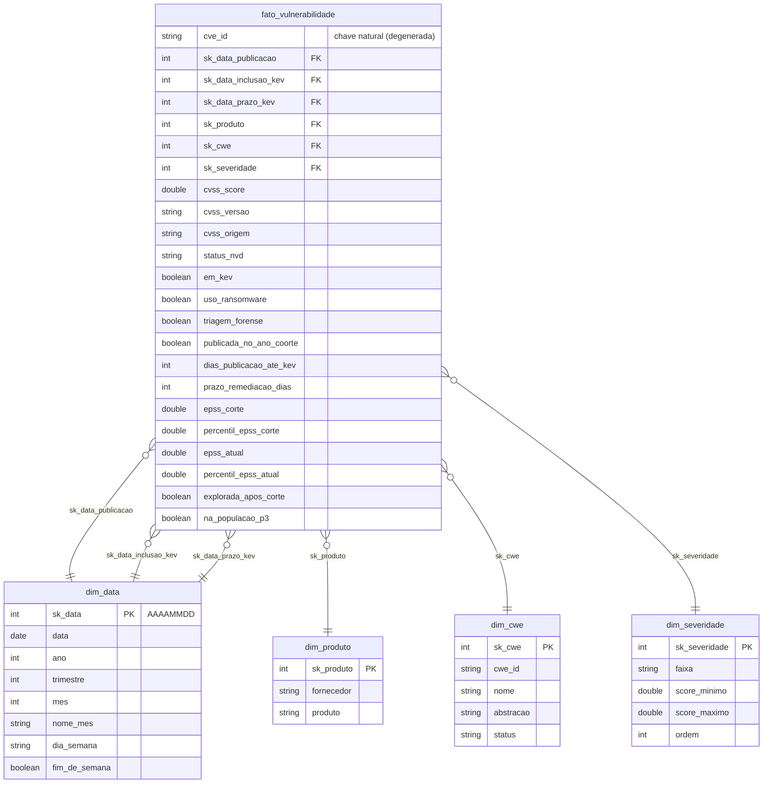

# Modelo de dados

## Arquitetura em camadas (medalhão) e linhagem

| Camada | Modelo | Carga | Propósito |
|---|---|---|---|
| landing | arquivos, como publicados | download (robô de coleta) | reprodutibilidade: bytes originais + hash |
| bronze | *flat* por fonte, estrutura original (inclusive aninhada) | leitura dos arquivos + colunas de linhagem | reprocessar sem baixar de novo |
| silver | *flat* por conceito (Data Lake), tipado e deduplicado | regras R1–R10 | base limpa e reutilizável |
| gold | **esquema estrela** (Data Warehouse) | regras R11–R15 | consultas analíticas das perguntas P1–P5 |

Todas as tabelas são sobrescritas a cada execução (carga completa e idempotente): o volume é
pequeno (≈ 42 mil CVEs) e isso elimina problemas de carga incremental num MVP.

## Esquema estrela (camada gold)

### Decisões de modelagem

* **Grão da fato: uma linha por CVE.** Todas as perguntas são sobre vulnerabilidades individuais;
  um grão mais fino (CVE × produto afetado) exigiria interpretar CPEs do NVD e multiplicaria
  linhas sem ganho para P1–P5.
* **`dim_data` com três papéis** (*role-playing dimension*): publicação, inclusão no KEV e prazo
  de correção compartilham o mesmo calendário.
* **Membro `-1` em todas as dimensões** (R14): CVEs fora do KEV não têm fornecedor/produto nem
  datas de KEV; em vez de chave nula, apontam para "Não informado". A fato nunca tem chave nula,
  o que é verificado automaticamente no notebook `04_gold` (zero chaves órfãs).
* **EPSS como medida da fato, e não como dimensão**: é um valor contínuo com dois instantes
  (corte e atual), guardados como colunas — o formato mais simples para comparar os dois.
* **Esquema estrela, e não snowflake**: as dimensões são pequenas (≤ 9 mil linhas) e
  desnormalizá-las simplifica as consultas sem custo relevante de armazenamento.

O detalhamento de cada atributo (tipo, domínio, nulos e linhagem) está no
[Catálogo de Dados](catalogo_de_dados.md).
